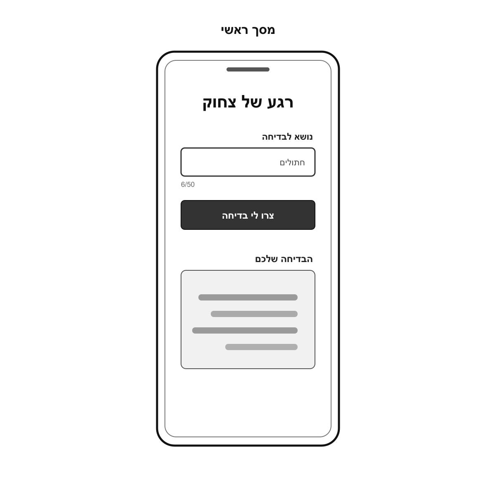
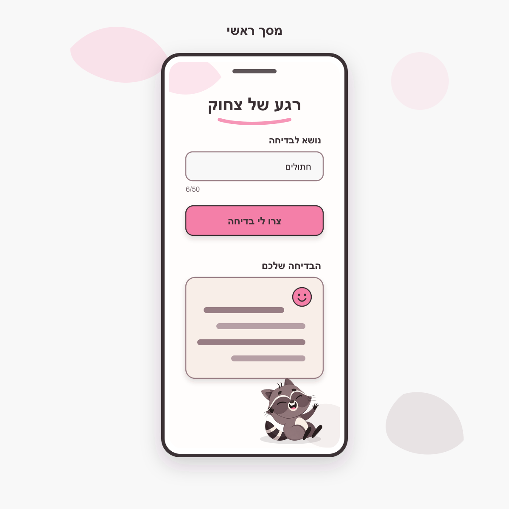
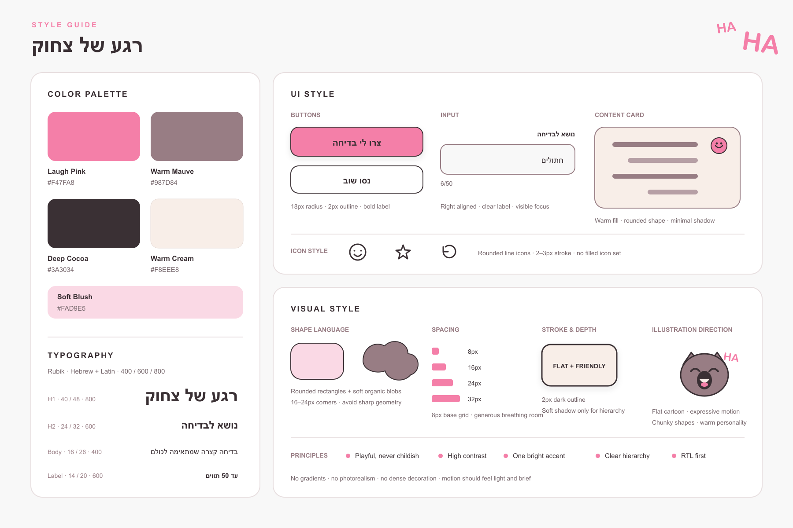

# DESIGN - רגע של צחוק

מסמך זה מתאר את המימוש העיצובי של האפליקציה על בסיס ה-PRD, ה-Wireframes, ה-Style Guide וה-Mockups המאושרים.

סדר הקדימות במקרה של אי-התאמה הוא:

1. ה-PRD קובע את התנהגות המוצר ואת אילוצי ה-UX.
2. ה-Wireframes קובעים את מבנה המסך ואת רכיבי ה-UI.
3. ה-Style Guide קובע את השפה החזותית.
4. ה-Mockups קובעים את המראה הסופי של המסך.

## 1. Screens - מסכי האפליקציה

האפליקציה כוללת מסך אחד בלבד. יצירת בדיחה, הצגת התוצאה, טעינה וטיפול בשגיאות מתרחשים באותו מסך ואינם יוצרים מסכים נוספים.

### Wireframe

### מסך ראשי

#### מטרת המסך

לאפשר למשתמש להזין נושא, או להשאיר את השדה ריק, ליצור בדיחה ולקרוא אותה באותו מקום ובתהליך קצר וברור.

#### מבנה ותוכן

המסך בנוי כעמודה יחידה ובכיוון RTL:

1. **כותרת המוצר:** "רגע של צחוק", ממורכזת ובולטת בראש אזור התוכן, עם קו ורוד מעוגל מתחתיה.
2. **אזור הזנת הנושא:**
   - תווית "נושא לבדיחה" מעל השדה וביישור לימין.
   - שדה טקסט בשורה אחת להזנת עד 50 תווים.
   - מונה תווים בפורמט `מספר נוכחי/50`, המוצג מתחת לשדה. הערך "6/50" ב-Mockup מייצג את הדוגמה "חתולים" ואינו תוכן קבוע.
3. **פעולה ראשית:** כפתור מלא ורוד עם הכיתוב "צרו לי בדיחה". הכפתור משתרע לרוחב אזור התוכן והוא האלמנט הפעיל הבולט במסך.
4. **אזור התוצאה:**
   - כותרת "הבדיחה שלכם" ביישור לימין.
   - כרטיס תוכן בגוון קרם להצגת בדיחה אחת.
   - אייקון חיוך קטן משמש חיזוק חזותי ואינו פעולה אינטראקטיבית.
   - הקווים ב-Wireframe וב-Mockup מייצגים טקסט דינמי של בדיחה ואינם Placeholder שיוצג במוצר.
5. **איור דקורטיבי:** דביבון צוחק מופיע בתחתית המסך, מתחת לכרטיס התוצאה. האיור אינו אינטראקטיבי, אינו מסתיר תוכן ואינו משנה את זרימת השימוש.

#### פעולות ומצבים

- המשתמש יכול להזין נושא, לערוך אותו או להשאיר את השדה ריק.
- לחיצה על "צרו לי בדיחה" שולחת בקשה אחת ליצירת בדיחה.
- בזמן יצירת הבדיחה יש להציג משוב ברור באותו מסך ולמנוע שליחה חוזרת של אותה בקשה, בהתאם ל-PRD.
- בתום הפעולה מוצגת בדיחה אחת בתוך כרטיס התוצאה.
- לאחר קבלת התוצאה המשתמש יכול לשנות את הנושא וללחוץ שוב על "צרו לי בדיחה".
- שגיאת קלט או תוכן שאינו מתאים יוצגו באותו מסך, בסמוך לאזור הרלוונטי, ללא מעבר לעמוד אחר.
- במקרה של כשל בחיבור או בשירות ה-AI תוצג באותו מסך פעולת "נסו שוב", בהתאם ל-PRD ולסגנון הכפתור המשני שב-Style Guide.
- נוסחי הודעות שלא הוגדרו ב-PRD אינם נקבעים במסמך זה.

#### התאמה למסכים שונים

- ב-Mobile נשמר מבנה אנכי ברוחב המסך, עם שוליים פנימיים ושטחי לחיצה נוחים.
- ב-Tablet וב-Desktop נשמרת אותה עמודה יחידה כשהיא ממורכזת, ללא מתיחה של השדה, הכפתור או כרטיס התוצאה לרוחב מלא של החלון.
- מידת הרוחב המרבית המדויקת אינה מוגדרת במקורות ויש לקבוע אותה במימוש תוך שמירה על היחסים המופיעים ב-Mockup.
- אם התוכן ארוך מגובה ה-Viewport, הדף נגלל אנכית והכרטיס גדל בהתאם לתוכן הבדיחה.

### Mockup מאושר

### מבנה הניווט הכללי

אין באפליקציה ניווט בין מסכים. כל הפעולות והמצבים מתרחשים במסך הראשי. אין Header ניווט, תפריט, Tabs או קישורים לעמודים נוספים.

## 2. Style Guide - השפה העיצובית

### Color Palette

| שם הצבע | HEX | שימוש מרכזי |
|---|---|---|
| Laugh Pink | `#F47FA8` | כפתור ראשי, הדגשות, אייקון חיוך ופרטים באיור |
| Warm Mauve | `#987D84` | קווי מתאר משניים, טקסטורות עדינות, קווים בכרטיס ופרטי איור |
| Deep Cocoa | `#3A3034` | טקסט ראשי, קווי מתאר כהים ואייקונים |
| Warm Cream | `#F8EEE8` | רקע כרטיס התוצאה ומשטחים חמים |
| Soft Blush | `#FAD9E5` | צורות רקע דקורטיביות והדגשות רכות |

רקע המסך והלוח הכללי נשאר בהיר מאוד. אין להשתמש בגרדיאנטים. יש לשמור על ניגודיות מספקת בין טקסט, רקע ורכיבים אינטראקטיביים.

### Typography

משפחת הגופנים היא **Rubik** עבור עברית ו-Latin, במשקלים `400`, `600` ו-`800`.

| רמה | גודל / גובה שורה | משקל | שימוש |
|---|---:|---:|---|
| H1 | `40px / 48px` | `800` | שם המוצר |
| H2 | `24px / 32px` | `600` | כותרות אזורים, כגון "הבדיחה שלכם" |
| Body | `16px / 26px` | `400` | טקסט הבדיחה והודעות |
| Label | `14px / 20px` | `600` | תוויות, מונה תווים וטקסט משני |

- הכותרת הראשית ממורכזת.
- תוויות, קלט, טקסט התוצאה והודעות מיושרים לימין.
- יש לשמור על גודל טקסט קריא גם במסכים קטנים, ללא הקטנה מתחת לערכים המוגדרים לצורך התאמת תוכן.

### UI Style

#### כפתורים

- פינות מעוגלות ברדיוס `18px`.
- קו מתאר כהה בעובי `2px`.
- Label מודגש וממורכז.
- הכפתור הראשי משתמש ב-Laugh Pink וברקע מלא.
- פעולת "נסו שוב" משתמשת בסגנון משני בהיר עם קו מתאר כהה.
- צל רך מותר רק כדי להדגיש היררכיה, כפי שמופיע ב-Mockup.
- מצבי Hover, Focus, Active ו-Disabled צריכים להישאר באותה שפה חזותית. ה-Focus חייב להיות גלוי, אך ערכיו המדויקים אינם מוגדרים במקורות.

#### שדה קלט

- רקע בהיר, פינות מעוגלות וקו מתאר בגוון Warm Mauve.
- התווית והטקסט מיושרים לימין.
- מונה התווים מופיע מתחת לשדה ואינו מתחרה בתווית.
- מצב Focus חייב להיות ברור ונגיש.
- השדה נשאר בשורה אחת ואינו גדל לגובה של Textarea.

#### כרטיס התוצאה

- רקע Warm Cream, פינות מעוגלות וקו מתאר בגוון Warm Mauve.
- צל מינימלי ורך מפריד את הכרטיס מהרקע.
- טקסט הבדיחה מיושר לימין ונשבר למספר שורות לפי הצורך.
- האייקון הדקורטיבי קטן ומשני ביחס לטקסט.
- גובה הכרטיס אינו קשיח במימוש ועליו להתאים לאורך הבדיחה.

#### אייקונים

- אייקוני Line מעוגלים בעובי `2-3px`.
- אין להשתמש בסט אייקונים מלא ומסיבי או באייקונים בעלי מילוי כבד.
- אייקון החיוך בכרטיס הוא דקורטיבי בלבד ולכן אינו מקבל Focus או תיאור כפעולה.

### Visual Style

#### צורות ופינות

- שפת הצורות מבוססת על מלבנים מעוגלים ו-Blobs אורגניים רכים.
- רדיוס הפינות הטיפוסי הוא `16-24px`.
- יש להימנע מגאומטריה חדה ומפינות מרובעות.

#### קווי מתאר ועומק

- קווי המתאר המרכזיים הם כהים ובעובי `2px`.
- צללים רכים משמשים רק להיררכיה של הכפתור, הכרטיס ומסגרת המכשיר בהמחשה.
- אין להשתמש בצללים כבדים, אפקטים תלת-ממדיים או Photorealism.

#### Spacing ו-Layout

- בסיס ה-Spacing הוא Grid של `8px`.
- המרווחים העיקריים הם `8px`, `16px`, `24px` ו-`32px`.
- יש לשמור על שטח נשימה נדיב בין אזור הקלט, הפעולה הראשית ואזור התוצאה.
- הפריסה היא Mobile-First, אנכית, נקייה וממורכזת.
- צורות הרקע הן דקורטיביות בלבד ואינן אמורות להפריע לקריאות או להיראות כרכיבים פעילים.

#### איורים ואווירה

- סגנון האיור הוא Flat cartoon בעל צורות מלאות, הבעה ברורה ואופי חם.
- דמות הדביבון המאושרת ב-Mockup היא האלמנט האיורי המרכזי. יש להשתמש בה כפי שהיא, ללא החלפת דמות או שינוי סגנון.
- האווירה צריכה להיות משחקית וחברותית, אך לא ילדותית.
- יש להשתמש במבטא צבעוני בהיר אחד דומיננטי, Laugh Pink, ולשמור את שאר המשטחים רגועים.
- אין להוסיף קישוטים צפופים, תמונות ריאליסטיות או אלמנטים שאינם תומכים בהיררכיה.
- אם תתווסף תנועה לאיור או למשוב, עליה להיות קלה וקצרה בלבד. אין במסמך זה דרישה לאנימציה מסוימת.

### שפה וכיווניות

- שפת הממשק וכל התוכן שנוצר היא עברית.
- המסמך הראשי של ה-UI מוגדר ב-RTL.
- תוויות, שדות, הודעות וטקסט הבדיחה מיושרים לימין, למעט הכותרת הראשית וטקסט הכפתורים הממורכזים.
- מחרוזות מספריות כגון מונה התווים צריכות להישאר קריאות בסדר חזותי תקין בתוך ממשק RTL.
- מונחים טכניים אינם מוצגים למשתמש אלא אם הם חלק מתוכן מוצר שאושר.

### עקרונות מחייבים למימוש

- Playful, never childish.
- High contrast.
- One bright accent.
- Clear hierarchy.
- RTL first.
- ה-Mockup המאושר הוא המקור המחייב למיקום הדביבון, לצבעוניות וליחסים החזותיים. ה-Wireframe משמש מקור למבנה בלבד.
